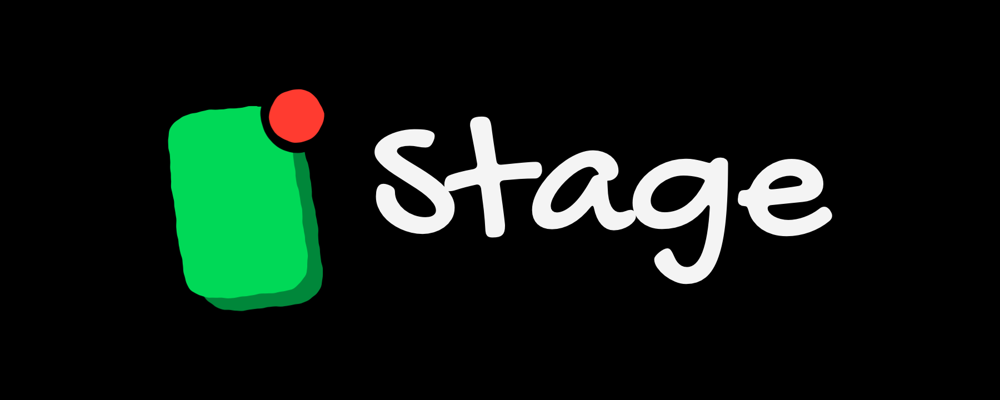

# Stage



A Mac app for showing and recording your iPhone screen, like QuickTime Player's
movie recording but made for demos: plug the phone in, share the Stage window in
a meeting, and record when you want to.

Needs macOS 27 or later, and an iPhone or iPad on a cable (USB). Over Wi-Fi
there is no way in for an app of its own, so Stage doesn't offer one.

## Use it

1. Connect the iPhone with a cable, unlock it, and tap **Trust** if asked.
2. Open Stage. The phone's screen appears within a few seconds.
3. Press **Space** (or ⌘R, or the red button) to start and stop recording.

Recordings are the phone's own video stream at its full native resolution.
The window holds only that picture, edge to edge. The controls float in a
strip of their own just under the window, never over the picture, and fade
away with nothing left behind; a meeting sharing the window never sees them. Recordings are saved to `~/Movies/Stage` as `<Device> 2026-10-15 at 15.03.12.mov`.

### Presenting in a meeting

- Share the **Stage** window (not the whole screen) in Zoom, Meet or Teams. With
  Stage Manager on, Stage's window stays beside the app in front instead of
  shrinking into the side strip, so the meeting can list and share it.
- The controls and pointer fade out after a moment; move the pointer over the
  window to bring them back. The window buttons stay hidden while the phone is
  showing (use ⌘W to close, ⌘M to minimize, ⌃⌘F for full screen).
- **View › Float on Top** (⌥⌘T) keeps it above your other windows. Browsers
  such as Chrome and Arc can't share a floating window, so leave it off to
  present Stage in Google Meet.
- Full screen (⌃⌘F) shows the picture on black.
- While recording, a red timer sits in the menu bar, outside the shared
  window. Click it to stop.
- The phone's sound is muted on the Mac by default, so your meeting mic doesn't
  pick it up twice. Use the speaker slider to hear it.

### Options (the ⌄ button, or Settings ⌘,)

- **Show**: switch between connected iPhones and iPads.
- **Record Sound From**: the phone, a microphone (to narrate), or no sound.
- **Video format**: H.264 (plays everywhere), HEVC (smaller), or ProRes 422 HQ
  (near-lossless for editing, much larger files).
- **When a recording stops**: save to the folder, or ask each time.

## Build

Needs Xcode 27 and XcodeGen (`brew install xcodegen`). `project.yml` signs with
the author's team; set `DEVELOPMENT_TEAM` to your own to build it yourself.

```bash
./scripts/build.sh            # Debug build, .build/main
./scripts/build.sh test       # unit tests
./scripts/build.sh release    # build/Stage.app
```

`Stage.xcodeproj` is generated from `project.yml`; don't edit it by hand.

The empty screen follows StarHash's empty states: a doodle drawn by
`python3 scripts/make_doodles.py` (StarHash's drawing engine and style) and a
title in Gochi Hand (`Stage/Resources/Fonts`), a marker hand that matches the
doodle's pen. The same script draws the logo, a portrait screen with the
record dot on its corner, in parts under `design/logo`. `scripts/make_icon.swift`
turns them into `Stage/AppIcon.icon`, an Icon Composer document: in light mode
the screen in white with the red dot on the brand green, in dark mode the logo
in its own colours on the system's dark background (the gap round the dot is a
real hole, so either shows through). It renders both to `design/AppIcon-light.png` and
`design/AppIcon-dark.png`, and writes the logo with its wordmark to
`design/Stage-logo.png`.

### Checking without a phone (Debug builds)

```bash
Stage.app/Contents/MacOS/Stage -demo idle -snapshot /tmp/stage.png
```

`-demo` takes `idle`, `recording`, `saved`, `landscape`, `connecting` or `empty`
and draws a fake phone. `-autoRecord <seconds>` records the live source, then quits. Every
flag needs a value: a lone word is read as a file to open, and macOS then
skips opening the window.

## How it works

macOS hides iPhone screens from apps until one opts in through CoreMediaIO
(`kCMIOHardwarePropertyAllowScreenCaptureDevices`), the same switch QuickTime
uses. The phone then appears as an AVFoundation capture device carrying picture
and sound. `CaptureEngine` runs one `AVCaptureSession` feeding the preview, an
`AVCaptureMovieFileOutput` and a speaker monitor; a frame output only watches the
picture size, so the window follows the phone when it rotates.

## License

Stage is source-available under the [PolyForm Noncommercial License 1.0.0](LICENSE).
You may use, study and change it for any non-commercial purpose. Selling it, or using it in
anything that earns money, is not allowed.

The Stage name and icon are not covered by the license: a modified version must use its own
name and icon.

## Credits

Gochi Hand by Juan Pablo del Peral (Huerta Tipográfica), under the SIL Open Font License 1.1
(`Stage/Resources/Fonts/OFL.txt`). The doodle drawing engine comes from
[StarHash](https://github.com/devbyshima/starhash).
